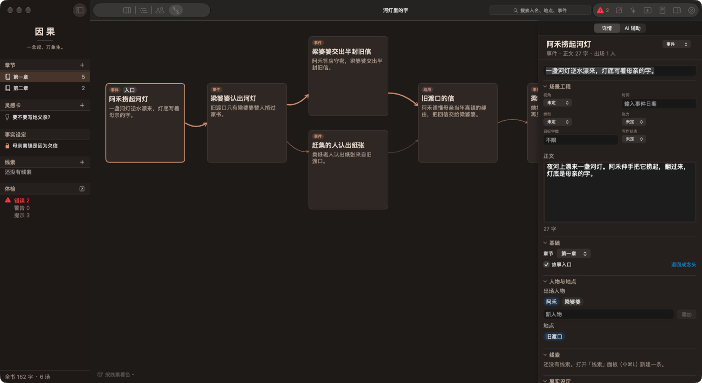
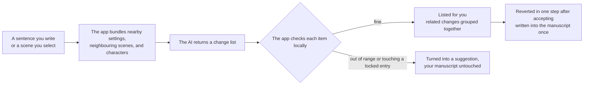

**English** · [简体中文](README.zh-Hans.md)

# Causality

A tool for people writing long-form, branching stories. It lays scene → choice → consequence out in front of you, so you can see the structure while you write and export both the manuscript and its diagram when you finish.

Requires macOS 15.0 or later, on Apple Silicon or Intel. Download the DMG and drag Causality into Applications.

---

## 1. Why this app exists

A branching story is the kind where the reader reaches a choice and can turn down another path.

With a long story, what blocks you is usually a concrete problem, and the sentence is rarely the one:

- You change one subplot and forget that a character on another path is still waiting for something that will never happen.
- You finish the outline and only then notice all three endings crowd the last two chapters, with nobody making a choice in between.
- You planted a setup, and at payoff time cannot recall which scene it lives in, so you page through twenty files.
- The plot conversation with the AI flows well, but when the model touches the draft you miss the five places it changed, and undoing leaves traces.

Behind all of these sits one cause: a story is a network, and our tools are lines. Documents stack chapters, folders stack files, and the fact you want to record — this choice causes that consequence, and the consequence lands on another character — has nowhere to live.

Causality is built around that idea, on three commitments:

1. **The basic unit is the scene and the fork.** A fork holds several options, each leading to a different next scene, each able to say why that route is taken. Two options that lead to the same scene still get one edge each, because in the author's mind they are different events.
2. **Reading order and causality are managed separately.** Order inside a chapter sets the reading rhythm; edges carry causality. Dragging a card on the storyboard changes reading order and leaves the plot alone; to change who causes whom you change the edge. The storyboard, outline, story graph, and character threads all read the same content, seen four ways.
3. **The AI proposes, you decide.** The model never edits your manuscript directly. It hands back a change list; the app checks each item, groups related ones for you, and reverts the whole list in one step after you accept it. Offline, everything except the AI features works: writing, viewing, saving, exporting.

It does different work from Scrivener and Twine, and works well alongside them:

| Tool | Handles | Leaves alone |
| --- | --- | --- |
| Scrivener | Filing text and source material | Whether a branch is reachable, whether causality holds |
| Twine | Turning a branching story into something clickable | Long-form writing, manuscript-ready outline, submission draft |
| Causality | Causality, which routes are reachable, whether setups pay off | Game engine, version control, ghost-writing for you |

It suits works of 80,000 words or more with three or more endings. For a 3,000-word single-path short story, a plain document is often quicker.

---

## 2. First run

Work through these four steps once; three spots that trip people up follow at the end of this section.

1. **Install**: open the DMG, drag Causality into Applications, double-click to launch. You land on the start page: new project, open project, and below them the drafts you have not finished (empty on first launch).
2. **Write your first scene**: choose File › New Project. A new project arrives with Chapter One and one first card. Right-click that card and choose "Write body", then write the scene; what you type is stored on that card and the card face shows the opening paragraph. To add another scene, click "Insert a card" at the bottom of the chapter.
3. **Add a branch**: after finishing that scene in writing mode, branch from Story › Fork From This Scene and write the other direction. Back on the storyboard the two scenes are joined by a fork edge, splitting into two routes, each labelled with a branch number (1, 2, …). Both routes stay.
4. **Check the structure, export the outline**: click Story › Writing Mode again to leave it. Use Story › Checkup for structural problems, Story › Branch Summary to see how many scenes and words each ending needs, and File › Export Outline PDF… to produce a printable outline.

Three spots trip people up the first time:

- **Closing the window quits Causality** (it has a single window). To close just the current project and leave the app running, use File › Close Project.
- **`.causal` looks like a single file in Finder** yet is really a folder. In the Open Project… panel it shows up as a folder; select the package itself and click Open. Double-clicking the file, or dragging it onto the Dock icon, sidesteps this.
- **New and imported projects are saved as drafts first**, so closing the window loses nothing. The first File › Save asks where to keep it for real — that draft entry on the start page is it.

---

## 3. Four views

One project, four ways to look at it: the storyboard for arranging scenes, the outline for reading order, the story graph for causality, character threads for people.

| View | What you see at a glance | Main actions | How to switch |
| --- | --- | --- | --- |
| Chapter storyboard (default) | One column per chapter, the whole book's rhythm laid out sideways | Insert cards, drag cards, write bodies, attach images | Story › View › Chapter Storyboard |
| Outline | Reading order by chapter, branches indented, merges as jumps | Reorder, inspect structure, export PDF | Story › View › Outline |
| Story graph | The whole book's causality as one diagram, edges read as "because… therefore…" | Pan, zoom, draw edges, trace main and side lines | Story › View › Story Graph |
| Character threads | Who shares a scene with whom, who relates to whom | Drag character cards, read the matrix, rename and note | Story › View › Character Threads |

### 3.1 Chapter storyboard (default)

One column per chapter, left to right from the first chapter to the last, top to bottom in the order you set. The left edge carries the chapter name and word count; the card face shows an excerpt of the body, tags for characters and places, and any image.

- **Insert a card**: hover between two cards and a `＋` appears; click it, type a thought, press Return to drop it into that chapter, or Esc to cancel. Every column also keeps an "Insert a card" button at the bottom.
- **Drag and drop**: cards move up and down, and across columns; on release the card lands between the two you dropped it on. Edges and bodies travel with the card.
- **Where the main line runs**: cards on the main line carry an accent bar on the left, so you can tell the trunk from the side branches at a glance.
- **Parallel groups**: forks carry a small marker and a branch number (1, 2, 3, …), each branch in its own colour; where routes reconverge a diamond is drawn. A group of branches folds into one small card, and the right-click menu lets you write the condition that sends a reader down that route, stored with the project.

### 3.2 Outline

The outline is derived from the same content, so you never write a second one. Scenes you read straight through sit side by side; a scene with several exits indents one level. A scene shows its body the first time it appears and a jump reference afterwards, so no paragraph is pasted twice; edges that cross chapters name their target chapter. Each chapter header gives scene count and word count.

- Dragging changes reading order only, never causality.
- Merge points show a jump reference, so the same body never appears twice.

### 3.3 Story graph

The story graph draws only the cards currently on screen and the edges between them. Scrolling zooms around the cursor, dragging empty space pans, and cards drag too.

- Edges normally show colour and weight only: thick for the main line, thin and pale for side lines. The causal text ("because…", "therefore…", "next…") appears when you hover an edge.
- Cards are laid out in reading order as a serpentine (first row left to right, second row right to left), adjacent cards at most one cell apart, so edges never cut across the whole screen. If it gets tangled, Story › Rearrange Story Graph fixes it, and the change can be undone.
- **Reachable endings**: right-click any card to list every ending reachable from it and how many steps away. Before changing a branch, you can see which endings will shift.

### 3.4 Character threads

Two readings: **relationship graph** and **matrix**.

- Relationship graph: one card per character, growing with content. Solid edges mean shared scenes, thicker for more of them; dashed edges mean causal or family relations; hovering an edge reveals which scene it comes from. Cards drag anywhere and their positions are remembered.
- Matrix: each cell is one character's state in one chapter, in four kinds — appears; only mentioned, never on stage; absent from the chapter; chapter not written yet. Beside it sit per-chapter word counts, first and last appearance, and the longest gap. Clicking a cell jumps to that scene.

---

## 4. Key concepts

These words keep appearing in the interface. Half a minute here makes the rest of the document read smoothly.

| Concept | What it means in Causality | Why it helps |
| --- | --- | --- |
| Scene | A narrative unit with a body, shown as its opening on the card. The interface calls it a "card", writing mode calls it a "scene"; it is the same thing | Many routes can reach one scene and it still stores one body, so you edit in one place |
| Choice point | A kind of scene: the reader arrives and must pick a route, with options and conditions living on the edges | Changing options or reasons never touches the scene itself |
| Ending | The other kind: a scene is an ending when no route leaves it | Marking endings is what lets the checkup find problems like "no route reaches this ending" |
| Idea card | A thought that stays on the board and never enters the outline | Once a thought leaks into the body it becomes an unwritten scene in the outline |
| Development edge | A causal edge between two scenes, with one sentence of causality and an optional condition. Drawing it says "because of the earlier scene, the later one follows" | That sentence is written for you; the app never uses it to judge the plot |
| Fact setting | A worldbuilding entry, in three tiers: draft, confirmed, locked | The tiers differ in strictness, and the AI can only touch the loosest one |
| Thread | A setup, theme, or character arc that spans chapters, ordered along the chapters so you can follow it end to end | One thread crosses many chapters, so you stop flipping chapter by chapter |
| Chapter | A container for reading order; a card belongs to exactly one | Deleting a chapter deletes its cards too; one Edit › Undo brings them all back |

---

## 5. Features in detail

In the order you actually use them: write first, check next, export last.

### 5.1 Writing mode

The storyboard is good for structure and bad for continuous prose: the cards are small and the surroundings are busy.

Select a scene and choose Story › Writing Mode. Only this scene's body remains in the middle: the end of the previous scene above, the start of the next below, this scene's characters and places on the right, and at the bottom the scenes this one leads to, one click away.

Story › Previous Scene and Next Scene page through; Story › New Next Scene continues the sequence; Story › Fork From This Scene copies the current scene and opens a new branch, leaving the existing route untouched. Leave and return and you are still on the scene you last wrote. The body saves as you type, with no manual save.

### 5.2 Details panel and scene engineering

The right column splits into nine blocks. Summary, Scene Engineering, and Body are open by default; Basics, Characters, Settings, Image, Exits, and Notes open on demand, and the collapsed state is remembered. Story › Show Right Column collapses or expands the column; Story › Focus Mode folds the sidebar away as well.

Scene Engineering is a set of writing prompts you fill in yourself: viewpoint (whose eyes this scene is seen through), time (when it happens in the story), type (what this scene does for the book), emotional intensity (how taut it should be), target word count, and stage (idea / draft / final). All of it can stay empty and you can still write. Fill any in and the target word count sits beside the actual count, and the character matrix and checkup use these fields too.

**How words are counted**: scenes, chapters, a single route, and the whole book all use one algorithm — characters for Chinese, words for English, with punctuation and spaces excluded. Those numbers therefore agree with each other.

**While typing**: long text such as bodies, notes, and character summaries is not recomputed on every keystroke; it is written once you pause or move away. Saving, exporting, and sending to the AI carry the last input along, so the final paragraph is never lost.

### 5.3 Idea cards and drafts

A thought that arrives mid-sentence is a shame to lose and a mess to push straight into the body.

Use Story › New Idea Card, or insert a card at the bottom of a column and write only that one line. Idea cards carry a small corner badge, stay out of the outline, and take no part in causality; after right-clicking "Turn Into Real Scene" they become real, keeping their number, image, and board position, and from then on appear in the outline and story graph.

Drafts are a separate matter: a new project is stored as a draft first, so closing the window loses nothing, and the permanent location is chosen at first save. The start page lists drafts and recently opened projects (at most 5 recent and 3 drafts); right-click to reveal in Finder, save a copy, copy the path, or move an unwanted one to the Trash. Drafts beyond the retained count, or untouched for 30 days, go to the Trash automatically; projects already saved for real are not affected.

### 5.4 Checkup

Once branches multiply, structural problems stop being visible by eye. Open Story › Checkup at any time and it scans the whole manuscript against 21 rules, in three levels — errors mean the story is broken and must change, warnings mean readers will be confused and should change, hints are details worth a look. Filter them, and click one to jump to its card. If a reminder does not apply, write a reason and ignore it; you can restore it later. A red number in the toolbar shows the current error count, hidden when there are none; the checkup section of the sidebar lists errors, warnings, and hints separately.

The rules cover three kinds of problem: routes that do not work (dead ends, unreachable endings), choices that are not choices (a fork with nothing to pick), and setups that never pay off. N01–N21 below are the rule numbers.

| Code | Level | Meaning |
| --- | --- | --- |
| N01 | Error | Dead end: a real scene is reachable but has no exit and is not marked as an ending |
| N02 | Error | Dangling ending: marked as an ending, but no route reaches it |
| N03 | Error | Ending with an exit: a scene with somewhere to go is not an ending |
| N04 | Error | Unreachable: no path arrives at it |
| N05 | Error | No explicit entry (the story never says where it starts) |
| N06 | Warning | Single-exit choice point (the reader has nothing to pick) |
| N07 | Warning | False choice: several options lead to the same scene with no difference |
| N08 | Hint | Unconditional fork (two routes, no reason given for either) |
| N09 | Warning | Cycle with no exit (scenes loop and never leave) |
| N10 | Hint | Endings too close (two endings sit so near that readers cannot tell them apart) |
| N11 | Warning | Branch never reaches an ending (a route stops halfway) |
| N12 | Error | No ending at all |
| N13 | Hint | Empty scene (no body yet) |
| N14 | Hint | Duplicate scene title (two scenes share a name and get mistaken for each other) |
| N15 | Hint | Main line unmarked (the board does not show which route is the trunk) |
| N16 | Warning | Setup never paid off |
| N17 | Error | Payoff before setup (a setup is resolved earlier than it is planted) |
| N18 | Warning | Setting conflict (two entries contradict each other) |
| N19 | Hint | Character gap (absent for a long stretch) |
| N20 | Hint | Structure contradicts type (a place that should fork does not, or an option point holds a non-choice scene) |
| N21 | Hint | Linear structure (one route through the whole book, no branches) |

### 5.5 Branch summary

Midway through a book you keep needing one answer: how many endings are there, and how long is each route. Open Story › Branch Summary to see each ending's scene count, word count, and number of choices, plus which scenes cannot be skipped. Read the pacing by story segment or the order step by step; the content exports as Markdown, and the AI can rewrite it to read better.

### 5.6 Threads

Setups, themes, and character arcs tend to span chapters, and filing them by chapter loses them. Create one in Story › Threads and attach scenes to it; it lines them up in chapter order so the scenes on that thread are visible at a glance. Cards on the thread carry a small dot (one per thread they belong to), and the story graph can colour by thread to follow that route alone. The "setup never paid off" and "payoff before setup" rules check exactly whether this line connects. Markdown and PDF exports include the thread appendix.

### 5.7 Playtest

Whether the structure works is best judged by reading it, and reading a whole book takes half a day. Story › Playtest walks from the entry point, offers the available options at each choice point, and lists the scenes visited in a panel where clicking any earlier one steps back to pick again; it also counts the words along the way. A route that cannot continue tells you which entry it started from. When you finish, export a read-through draft marked with each choice.

### 5.8 Search

The toolbar search box finds cards by character name, place, or event name, and jumps straight to a hit. Clicking a character in character threads also traces every appearance.

### 5.9 AI assistance

You can write one sentence first and let the AI turn it into an outline of scenes worth writing. It reports a change list; accepting is your call.

Switch the right column to AI Assistance, or click the AI button in the toolbar. Three entry points:

- **Discuss**: writes only into the conversation, touching no manuscript. Lines that come out of the discussion can be collected as an idea or recorded as a setting.
- **Turn into outline**: sorts the existing agreement into scenes, leaves open questions as pending items, and returns a proposal.
- **Revise the selection / Insert a card here**: click the gap between two cards first and the panel shows "Insert at: Chapter One · after '…'", at which point the main button becomes "Insert a card here".

Before sending, the materials going out this round are listed below the input and can be removed one by one; removed items are not sent. Scope switches between this chapter and the whole book; a discussion carries the last 12 rounds by default. After a change lands in the manuscript, Edit › Undo reverts it in one step; once reverted, the same change can be accepted again. If the AI stops halfway, your input and the original manuscript both survive, and the error is recorded in the conversation.

**How much goes in one request**: up to roughly ten thousand-plus words of material, trimmed against the service's own limits when it goes over. Items you do not want can be deleted before sending; a failed request retries twice automatically and whatever arrived is kept.

### 5.10 Fact settings

Worldbuilding entries come in three tiers: draft, confirmed, locked. Drafts stay local; confirmed entries travel with the material sent to the AI; locked entries cannot be changed, deleted, or unlocked by the AI, and deleting a scene that references one leaves it standing.

### 5.11 Importing Markdown

If you already have a script, a scene-by-scene outline, or a setting document, you do not have to start from an empty board. Use File › Import Markdown…, pick a `.md`, and the format decides between two imports:

- The file contains a table starting with "Beat and Timing" → **storyboard import**: each row becomes a card, placed in its chapter in table order, with all four columns written into the body. It does not draw causal edges for you; the "where it starts / what happens next" columns are written for a human reader, so connect the scenes on the story graph afterwards.
- Plain Markdown → **prose import**: `#` names the book, `##` is a chapter, `###` (or `####`) is a scene, and paragraphs go into bodies; sections such as `## Characters`, `## Places`, and `## Settings` are treated as setting lists rather than chapters (the spellings "roles", "locations", and "world" are recognised too).

An imported project behaves like a new one: stored as a draft first, with the permanent location chosen at first save. Prose import tells you how many chapters and scenes it found (shown as "N chapters, M scenes"), and parsing problems are listed as notes — fix the source and import again.

---

## 6. Settings

Two tabs, reached from Causality › Settings….

### 6.1 Appearance

- Mode: follow the system, light, dark.
- Colour scheme: 20 sets, one version for light and one for dark, each with a mini storyboard preview of the same scheme so you can see the result directly.
- Type size: body 16; headings scale by level (panel titles 22, writing mode 28); labels on the canvas and cards are smaller; zoom the story graph out far enough and cards show their title alone. Text and background contrast is tuned to readable standards, clear in both light and dark.
- Interface language: follow the system, Simplified Chinese, English, Japanese, Traditional Chinese. Menu bar and About window text changes after a restart.

### 6.2 AI services

Pick whichever service your AI account belongs to, and the key field shows asterisks. Everything except ChatGPT needs an API key from that service's own site, pasted in and saved; for services not listed, fill in the endpoint under Custom Provider at the bottom.

| Service | How to use it |
| --- | --- |
| ChatGPT | Uses the Codex already signed in on this Mac (install Codex and sign in once); no key needed |
| DeepSeek | Paste a DeepSeek API key |
| OpenCode Go | Paste an OpenCode Go API key |
| OpenRouter | Paste an OpenRouter API key |
| Kimi | Paste a Kimi API key |
| MiniMax (China) | Paste a MiniMax API key |
| Qwen | Paste a Qwen API key |
| Google Gemini | Paste a Gemini API key |
| Doubao (Volcano Ark) | Paste a Volcano Ark API key |
| Custom provider | Fill in the endpoint and model name yourself |

**Splitting the work**: you do not have to run everything on one service. Split into "planning / outline" and "writing", each with its own service and model — plan the structure with ChatGPT, hand the sentence work to DeepSeek, for instance.

**Key safety**: keys are kept on this Mac only and shown as asterisks; they never go into the project package, an export, or the installer. On another machine or for another person, you see that machine's own credentials; services without a key show "no API key configured". The installer and project packages contain no account or login state.

**If you use ChatGPT**: install Codex on this Mac and sign in once, then pick ChatGPT and it works — the app only reads that sign-in, never changing or copying it. Without a sign-in it shows "not signed in", and an expired one prompts you to sign in again in the browser rather than failing silently.

---

## 7. Exporting

Several ways out, none of them needing a network: keep editing with the project package, keep writing with Markdown, show someone with PNG, print with PDF, circulate an internal read with the read-through draft.

### 7.1 The `.causal` project package

`.causal` is a folder that Finder presents as a single file, so it copies, mails to yourself, and travels between machines. Inside sit bodies, structure, edges, canvas positions, images, and conversation records.

Saving writes the new content first and replaces the old file after, so quitting midway never leaves half a project; the package also keeps one snapshot of the previous version for recovery. When the app, the command line, and another tool change the same package at once, the later save stops and asks you to choose: save a copy, overwrite the file with the new content, or reload what is in the file.

### 7.2 Markdown

File › Export Markdown… exports by chapter, keeping scene titles, characters and places, causal text, options and conditions, and ending marks; images go alongside as relative paths. The Markdown follows the outline view's arrangement, with the content unchanged.

### 7.3 Story graph PNG

File › Export Story Graph PNG… exports the whole graph or just the part on screen, on white, with causal text kept legible. Good for planning notes, or for showing the structure to someone.

### 7.4 Outline PDF

File › Export Outline PDF… produces A4 two-column pages, paginated by chapter, bodies and images laid out together (images scaled to fit the page), with a thread appendix at the end. Idea cards get their own column, which makes for easy reading and annotation.

### 7.5 Read-through draft

Exported from the playtest panel: one route's bodies top to bottom, marked with each choice taken. Useful for internal read-throughs and for testers.

### 7.6 Command line and AI-facing interface

There is also a command-line tool, `causal`. If you live in a terminal, put it in scripts to check, export, and edit projects in bulk; the complete commands and arguments are in `docs/cli.md`. To let AI clients such as Codex, Hermes, and Pi read and write a project directly, work through section 9.

The same tooling ships an interface for AI clients, letting them read and write your project directly. Changes are written to the file only on save; when two people edit the same package at once it stops and asks you to choose rather than overwriting quietly.

---

## 8. Performance

Measured on a project with 500 scenes, 800 edges, and 12 chapters, running `causal bench` on an Apple Silicon Mac:

| Item | Result |
| --- | --- |
| Opening that project | 68 ms (median of five) |
| One scene lookup / one outline | 1.2 ms / 1.0 ms |
| Exporting Markdown | 3.4 ms |
| Resident memory | 20 MB |

At that scale the story graph spreads across more columns automatically, and panning and zooming only simplify distant detail instead of stalling.

---

## 9. Generating storyboards from outside (MCP / CLI)

Available once the app is installed; no terminal needed.

### 9.1 One click to set it up

Open **Settings (⌘,) › MCP** and click "Install MCP in one click". That one button does three things: it installs the bundled `causal` (which is also the MCP server) into `.local/bin` under your home directory; it registers it with the Codex (GPT), Hermes, and Pi found on this machine; and it tests each connection in turn. No terminal, no config files to open.

Paths are computed from your home directory at that moment rather than hard-coded to one machine. The whole setup runs once; after an app update, click again to switch to the new version. The **Tools** menu holds the same entry.

### 9.2 Checking whether it connected

Further down the same page, clients are listed one per line, each ending in its verdict:

| Shown | Meaning |
| --- | --- |
| Connected, 15 tools available | Configuration written, handshake succeeded |
| Not connected yet | Client installed, but its config has no Causality entry |
| Failed: reason | Writing or connecting failed, with the reason after the colon |

Click "Install MCP in one click" again for the ones not connected, or use "Recheck" on that line.

Below that sit **desktop clients**: Claude Desktop, Cursor, Windsurf, Kiro, VS Code, OpenCode. Whichever you have installed shows up by itself (these clients have no command line and connect through a JSON config). "Installed" means the app bundle or command exists; an empty config file alone does not count, so clients you never installed stay off the list. Click "Write and check" — the app edits that client's config directly, backing the original up as `…bak-mcp-<time>` first and reading it back to verify; each line shows the exact path of that file, and "Reveal in Finder" opens its folder. If its config is not standard JSON, the app leaves it alone and writes the reason on that line.

Only clients in neither list (DSH and the like, with no fixed location) need manual work: click "Copy this config" and paste it into the MCP section of that client's settings. **Do not select and copy the preview text by hand**: that drags along escapes such as `\n` and `&#x20;`, and the paste will be broken.

Once installed, typing `causal` in a terminal may report that the command is not found, because `.local/bin` is not on the default `PATH`; use the full path, or the one the app wrote (it writes an absolute path).

### 9.3 Having an AI build a storyboard

Paste the following into a session already connected over MCP (swap in your own paths and content):

> Use causal to create a project at `/Users/you/Documents/LettersInRain.causal`: call `open_project` first; create three chapters "Act One / Act Two / Act Three" with 4 scenes each, titled like "S01 The Envelope", bodies around 60 words describing the place, the characters, and what the scene advances; connect scene to scene with `connect`; add two forks with two outgoing edges each, converging on the same ending; run `validate` after each batch and `save_project` when everything is done; finally report how many chapters, scenes, forks, and endings there are.

Four things that cause rework:

- `apply_ops` changes memory only; **without `save_project` nothing is saved**.
- Refer to cards by name rather than UUID; a duplicate name is rejected with the candidates listed.
- `undo` reverts a bad edit; `history` shows what happened first.
- The checkup is not in MCP: go back to the app and press `⇧⌘A`, or run `causal audit yourproject.causal`.

### 9.4 Back in the app

Double-click the `.causal` package and its cards are on the storyboard; `⇧⌘A` checks for dead ends and missing endings, `⇧⌘B` shows how many scenes each ending needs. When the app and the AI edit the same package at once it stops and asks you to choose (save a copy / overwrite the file / reload / cancel), so nothing is overwritten quietly.

Where config files live, the full list of 15 tools and operations, and troubleshooting are in `docs/mcp.md`.

---

## 10. Keyboard shortcuts

Everything here is also reachable through menus, so nothing has to be memorised.

| Shortcut | Action |
| --- | --- |
| `⌘N` / `⌘O` | New project / open project |
| `⇧⌘R` | Rename project |
| `⇧⌘I` | Import Markdown |
| `⌥⌘W` | Close project |
| `⌘S` / `⇧⌘S` | Save / save as |
| `⇧⌘E` / `⇧⌘G` / `⇧⌘P` | Export Markdown / story graph PNG / outline PDF |
| `⌘Z` / `⇧⌘Z` | Undo / redo |
| `⌥⌘N` | New scene |
| `⌘⏎` | Enter / leave writing mode |
| `⌘↑` / `⌘↓` | Previous / next scene in writing mode |
| `⇧⌘⏎` | New next scene |
| `⇧⌘D` | Fork from this scene |
| `⇧⌘A` | Checkup |
| `⇧⌘B` | Branch summary |
| `⇧⌘L` | Threads |
| `⌥⌘P` | Playtest |
| `⌥⌘I` / `⌥⌘R` | Show right column / focus mode |
| `⌘,` | Settings |

---

## 11. License and feedback

MIT licensed; the full terms are in `LICENSE`. To work on the code, see `CONTRIBUTING.md`; to report a security problem, use the address in `SECURITY.md` rather than a public issue. The full arguments for the command line and the AI-facing interface are in `docs/cli.md`.

If something does not work, or a sentence here reads wrong, open an issue on the repository.
