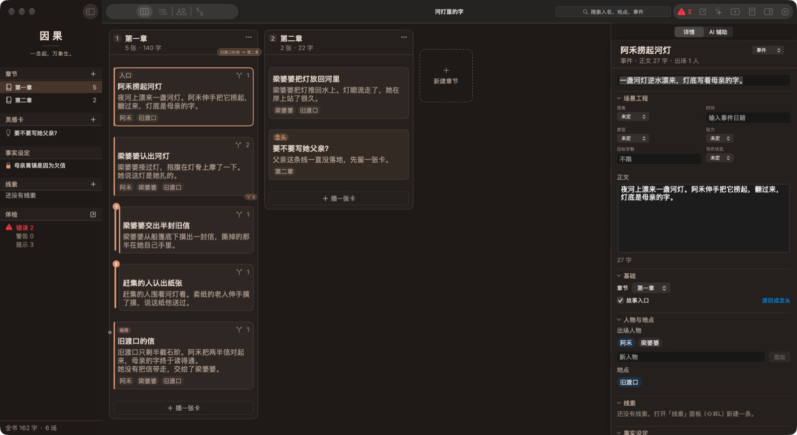
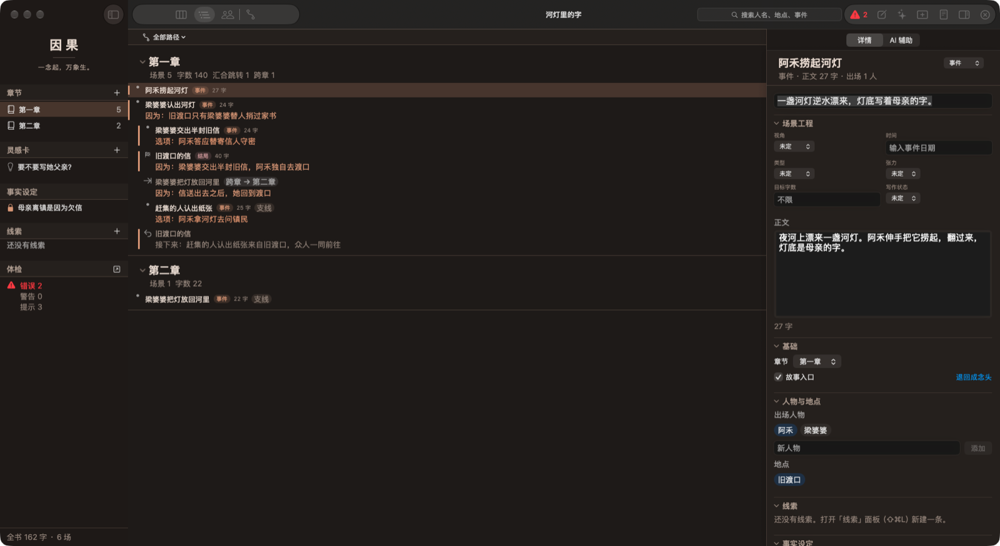
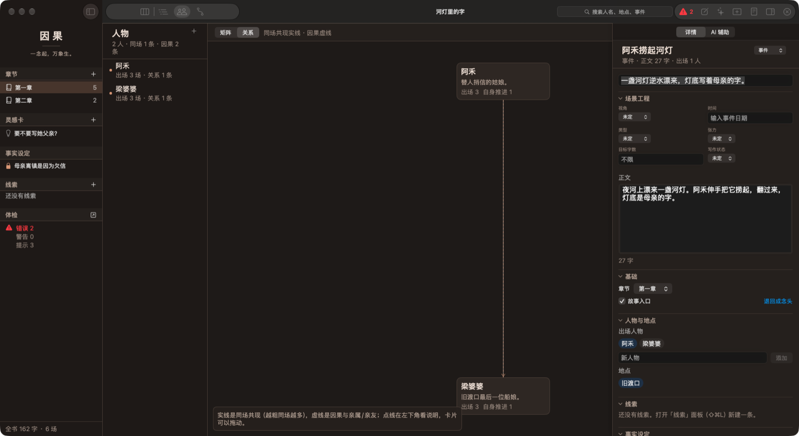
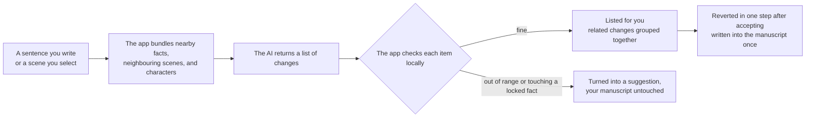
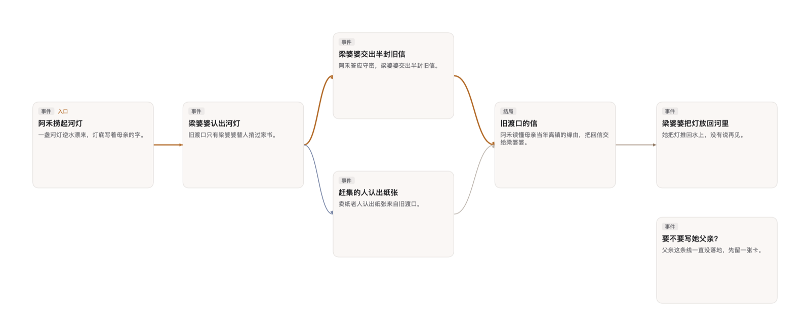
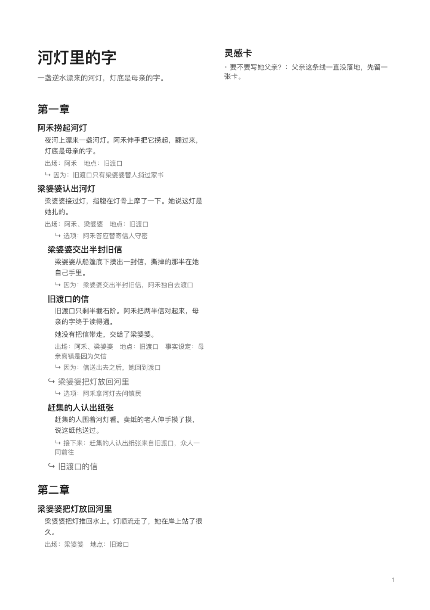

**English** · [简体中文](README.zh-Hans.md)

# Causality

A writing tool for long-form branching stories. Causality puts scene, decision, and consequence on one surface, so the shape of the book stays visible while you draft, and the manuscript and its diagram come out when you finish.

Requires macOS 15.0 or later, on Apple Silicon or Intel. [Download the DMG](https://github.com/dynaeye/causality/releases/download/v1.0.0/Causality-1.0.0.dmg) and drag Causality into Applications.

---

## 1. Why this app exists

A branching story is one where the reader reaches a point and can turn down another path.

With a long story, what stops you is usually something concrete:

- You rework one subplot and forget that a character on another path is still waiting for something that will never happen.
- The outline is done before you notice all three endings crowded into the last two chapters, with nobody making a decision in between.
- You planted a setup, and at payoff time you cannot remember which scene holds it, so you page through twenty files.
- The plot talk with the AI goes well, but when the model edits the draft you miss the five places it changed, and undo leaves a mess.

All four share a cause. A story is a network, while the tools are lines: documents stack chapters, folders stack files, and the thing you want to record — this decision causes that consequence, and the consequence lands on somebody else — has nowhere to go.

Causality is built on that idea, with three commitments:

1. **The unit is the scene and the fork.** A fork carries several options, each leading to a different next scene, each with a line saying why a reader takes it. Two options that land on the same scene still get an edge each, because to the author they are different events.
2. **Reading order and causality stay apart.** Order inside a chapter sets the rhythm of reading; edges carry cause. Dragging a card on the storyboard reorders the reading and leaves the plot untouched. Changing who causes whom means changing the edge. Storyboard, Outline, Story Graph, and Character Map all read one piece of content four ways.
3. **The AI proposes, you decide.** The model hands back a list of changes; the app checks every item, groups related ones together, and lets you revert the whole list in one step after you accept it. Offline, everything but the AI features keeps working: writing, browsing, saving, exporting.

It does different work from Scrivener and Twine, and the three work well side by side:

| Tool | Handles | Leaves alone |
| --- | --- | --- |
| Scrivener | Filing text and source material | Whether a branch is reachable, whether causality holds |
| Twine | Turning a branching story into something clickable | Long-form drafting, manuscript-ready outline, submission copy |
| Causality | Causality, which routes are reachable, whether setups pay off | Game engine, version control, writing the book for you |

It suits books of 80,000 words or more with three or more endings. For a 3,000-word single-path short story, a plain document is usually quicker.

---

## 2. First run

Four steps for the first session. Three easy mistakes follow at the end of this section.

1. **Install**: open the DMG, drag Causality into Applications, double-click. The start page offers New Project and Open Project, with your unfinished drafts listed below (empty on the first launch).
2. **Write the first scene**: File › New Project opens with Chapter One and one card, titled First Card. Right-click the card, choose Write Scene, and write. The text lives on that card, and the card face shows the opening lines. Add the next one with Insert Card at the foot of the chapter.
3. **Add a branch**: from writing mode, Story › Branch from This Scene splits off a second direction and you write that too. On the storyboard the two scenes are joined by a fork edge, labelled with branch numbers (1, 2, …), and both routes stay.
4. **Check the structure and export**: Story › Writing Mode (⌘⏎) leaves writing mode. Story Check (⇧⌘A) lists structural problems, Branch Synopsis (⇧⌘B) shows the scenes and words behind each ending, and File › Export Outline as PDF… gives you something printable.

Three things trip people up at the start:

- **Closing the window quits Causality**, because it has a single window. File › Close Project closes the project and leaves the app running.
- **Finder shows a `.causal` as one file**; it is really a folder. The Open Project… panel therefore lists it as a folder — select the package itself and press Open. Double-clicking the file, or dropping it on the Dock icon, avoids the question.
- **New and imported projects start as drafts**, so closing the window loses nothing. The first Save asks where the project should live for real; that draft on the start page is the same project.

---

## 3. Four views

One project, four ways to look at it: the storyboard for arranging scenes, the outline for reading order, the story graph for causality, the character map for people.

| View | What you see | What you do there | Where to switch |
| --- | --- | --- | --- |
| Storyboard (default) | One column per chapter, the book's rhythm laid out sideways | Insert and drag cards, write scenes, attach images | Story › View › Storyboard |
| Outline | Reading order by chapter, branches indented, merges as jumps | Reorder, inspect structure, export the PDF | Story › View › Outline |
| Story Graph | The book's causality in one diagram, edges read as "because… therefore…" | Pan, zoom, draw edges, follow mainline and subplot | Story › View › Story Graph |
| Character Map | Who shares a scene with whom, who relates to whom | Drag character cards, read the matrix, rename and annotate | Story › View › Character Map |

### 3.1 Storyboard (default)

One column per chapter, first to last left to right, your order top to bottom. The chapter name and word count sit at the top of the column; the card face carries an excerpt, tags for characters and places, and any image.

- **Insert a card**: hover between two cards and a `＋` appears. Click it, type the thought, Return drops it into that chapter, Esc cancels. Every column also keeps Insert Card at the bottom.
- **Drag and drop**: cards move within a column and across columns; on release a card lands where you dropped it, and edges and text follow it.
- **Where the mainline runs**: cards on the mainline carry an accent bar on the left, so mainline and subplot read apart at a glance.
- **Branch groups**: a fork shows a small marker and a branch number (1, 2, 3, …), each branch in its own colour, and a diamond where routes merge again. A group folds into one small card, and the right-click menu lets you write the condition that sends a reader down a branch, saved with the project.

### 3.2 Outline

The outline is derived, so you never write a second one. Scenes you read straight through sit side by side; a scene with several exits indents one level. A scene shows its text the first time it appears and a jump afterwards, so no paragraph is pasted twice; an edge that crosses chapters names its target chapter. Each chapter header gives scene count and word count.

- Dragging reorders the reading and leaves causality where it was.
- A merge shows a jump, so the same text never appears twice.

### 3.3 Story Graph

The story graph draws the cards currently on screen and the edges between them. The wheel zooms around the cursor, dragging empty space pans, and cards drag too.

- Edges usually show colour and weight alone: thick on the mainline, thin and pale on subplots. The causal text ("because…", "therefore…", "next…") appears when you hover an edge.
- Cards lay out in reading order as a serpentine — first row left to right, second row right to left — with neighbours at most one cell apart, so no edge cuts across the whole screen. When it tangles, Story › Arrange Story Graph sorts the layout out and you can undo it.
- **Reachable endings**: right-click any card to list the endings reachable from it and the steps to each. Before cutting a branch, see which endings move with it.

### 3.4 Character Map

Two readings: the relationship graph and the matrix.

- Relationship graph: one card per character, growing with its content. A solid edge means the two appear in scenes together, thicker where they share more; a dashed edge means cause or kinship. Hover an edge to see the scene it came from. Cards drag anywhere and remember where you put them.
- Matrix: each cell is one character in one chapter, in one of four states — on stage, mentioned but off stage, absent from that chapter, chapter not written yet. Beside the matrix sit the per-chapter word counts, the first and last appearance, and the longest gap. Click a cell to jump to that scene.

---

## 4. Key concepts

These words come up throughout the interface, and half a minute here makes the rest of this document read smoothly.

| Concept | What it means in Causality | What it buys you |
| --- | --- | --- |
| Scene | A narrative unit with text of its own, its opening shown on the card. The interface says card, writing mode says scene, and both mean this | A scene reached by several routes still stores one body, so there is one place to edit |
| Decision | A kind of scene: the reader arrives and picks a route, with the options and their conditions living on the edges | Editing options or reasons leaves the scene itself alone |
| Ending | The other kind: a scene with nowhere left to go | Marking endings lets Story Check find problems such as an ending nobody can reach |
| Idea card | A thought that stays on the board and stays out of the outline | An idea in the manuscript turns into an unwritten scene in the outline |
| Story link | A causal edge between two scenes, with one line of causality and an optional condition. Drawing one says the later scene follows from the earlier | That line is written for you; the app never reads it to judge the plot |
| Story fact | A worldbuilding entry at one of three levels: draft, confirmed, locked | The levels differ in strictness, and the AI may touch only the loosest |
| Thread | A setup, theme, or character arc that spans chapters, lined up along them so you can follow it end to end | One thread crosses many chapters, so you stop flipping through them |
| Chapter | A container for reading order; a card belongs to exactly one | Deleting a chapter deletes its cards, and one Undo brings them all back |

---

## 5. Features in detail

In the order you meet them: write, then check, then export.

### 5.1 Writing mode

The storyboard suits structure and fights continuous prose: the cards are small and the surroundings busy.

Select a scene and choose Story › Writing Mode. Only this scene's text stays in the middle: the end of the previous scene above, the start of the next below, this scene's characters and places on the right, and at the bottom the scenes it leads to, one click away.

Story › Previous Scene and Next Scene page through the book, Story › Add Next Scene continues the run, and Story › Branch from This Scene copies the current scene into a new branch while the existing route stays as it was. Come back later and you are still on the scene you left. The text saves as you type.

### 5.2 Inspector and Scene Craft

The inspector holds nine sections, with the summary on top. Scene Craft and Manuscript open by default; Basics, Characters & Places, Threads, Story Facts, Images, Leads to, and Notes open on demand, and the app remembers what you collapsed. Story › Show Inspector closes and opens the inspector; Story › Focus Mode folds the inspector away as well.

Scene Craft is a set of writing prompts you set yourself: point of view (whose eyes this scene is seen through), time (when it happens in the story), type (what the scene does for the book — Dialogue, Cutscene, Exploration, Puzzle, Combat, Boss, Montage), tension (how taut it should be, one to five), target words, and writing status (To write / In progress / To revise / Final). Every field can stay empty and the scene still writes. Fill any in and the target word count sits beside the actual count; the character matrix and Story Check read the same fields.

**How words are counted**: scenes, chapters, a single route, and the whole book share one rule — characters in Chinese, words in English, with punctuation and spaces left out — so the numbers agree with each other.

**While you type**: long text such as scene bodies, notes, and character summaries is not recomputed on every keystroke; it lands when you pause or move away. Save, export, and AI requests carry the last input along, so the final paragraph is never lost.

### 5.3 Idea cards and drafts

A thought that arrives mid-sentence is a shame to lose and a mess to push straight into the manuscript.

Use Story › New Idea Card, or insert a card at the foot of a column and write that single line. Idea cards carry a small corner badge, stay out of the outline, and take no part in causality. Right-click Convert to Scene and the card becomes a real scene, keeping its number, image, and place on the board; from then on it appears in the outline and the story graph.

Drafts are a separate matter. A new project is stored as a draft first, so closing the window loses nothing, and the permanent location is chosen at the first save. The start page lists drafts and recently opened projects (at most 5 recent and 3 drafts); right-click to reveal in Finder, save a copy, copy the path, or move an unwanted one to the Trash. Drafts beyond the retained count, or untouched for 30 days, go to the Trash on their own; projects already saved for real are unaffected.

### 5.4 Story Check

Once branches multiply, structural problems stop being visible by eye. Story › Story Check (⇧⌘A) scans the whole book against 21 rules at three levels: an error means the story is broken and has to change, a warning means readers will be confused and should be fixed, a note is a detail worth a look. Filter the list, click a finding to jump to its card. When a reminder does not apply, write a reason and ignore it, and restore it later. A red number in the toolbar counts the current errors and stays hidden at zero; the Story Check section of the inspector breaks errors, warnings, and notes apart.

The rules cover three kinds of trouble: routes that do not work (dead ends, endings nobody reaches), decisions that decide nothing (a fork with one exit, options that lead to the same scene), and setups that never pay off. N01–N21 are the rule numbers.

| Code | Level | Meaning |
| --- | --- | --- |
| N01 | Error | Dead End: a real scene is reachable, has no exit, and is not marked as an ending |
| N02 | Error | Floating Ending: marked as an ending, but no route arrives at it |
| N03 | Error | Ending Still Has Exits: a scene with somewhere to go is not an ending |
| N04 | Error | Unreachable: no path arrives at it |
| N05 | Error | No Explicit Entry: nothing marks where the story starts |
| N06 | Warning | Single-Exit Choice: the reader has one route and no decision |
| N07 | Warning | False Choice: several options lead to the same scene with no difference |
| N08 | Note | Unconditional Branch: two routes, and no reason given for either |
| N09 | Warning | Loop Without Exit: scenes circle each other and never leave |
| N10 | Note | Ending Too Close: two endings sit so near that readers cannot tell them apart |
| N11 | Warning | Branch Misses Every Ending: a route stops halfway |
| N12 | Error | No Ending: the book has none |
| N13 | Note | Empty Scene: no text yet |
| N14 | Note | Duplicate Scene Titles: two scenes share a title and get mistaken for each other |
| N15 | Note | Mainline Unmarked: nothing on the board says which route is the trunk |
| N16 | Warning | Unresolved Thread: a setup planted and never paid off |
| N17 | Error | Payoff Before Setup: a setup resolves earlier than it is planted |
| N18 | Warning | Fact Conflict: two story facts contradict each other |
| N19 | Note | Character Gap: a character absent for a long stretch |
| N20 | Note | Type and Structure Diverge: a place that should fork does not, or an option point holds a scene that decides nothing |
| N21 | Note | Linear Structure: one route through the whole book |

### 5.5 Branch Synopsis

Midway through a book you keep needing the same answer: how many endings are there, and how long is each route. Open Story › Branch Synopsis for each ending's scene count, word count, and number of decisions, plus the scenes that cannot be skipped. Read the pacing by story segment or the order step by step. The content exports as Markdown, and the AI can rewrite it to read better.

### 5.6 Threads

Setups, themes, and character arcs usually span chapters, and filing them by chapter loses them. Create one in Story › Threads and attach scenes to it; the thread lines them up in chapter order, so the scenes on it are visible at once. Cards on a thread carry a small dot, one per thread they belong to, and the story graph can colour by thread to follow that route alone. The Unresolved Thread and Payoff Before Setup rules check exactly whether this line connects. Markdown and PDF exports carry the thread appendix.

### 5.7 Play Through

The best test of structure is reading the book, and reading the book takes half a day. Story › Play Through walks from the entry, offers the available options at each decision, and lists the scenes visited in a panel where clicking any earlier one steps back to choose again; it counts the words along the way too. A route that cannot continue says which entry it started from. When you finish, export a reading copy marked with each choice.

### 5.8 Search

The toolbar search box finds cards by character name, place, or event name and jumps to the hit. Clicking a character in the character map traces every appearance as well.

### 5.9 AI assistance

You can write one sentence and let the AI turn it into an outline of scenes worth writing. It reports a list of changes, and accepting is your call.

Switch the inspector to the AI assistant, or click the AI button in the toolbar. Three ways in:

- **Discuss**: writes into the conversation only, touching no manuscript. Lines the discussion produces can be saved as an idea or recorded as a fact.
- **Create Outline**: sorts what you have agreed into scenes, leaves open questions as pending items, and returns a proposal.
- **Revise Selection / Insert a card here**: click the gap between two cards first, and the panel shows `Insert at: Chapter One · after “…”`, at which point the main button becomes **Insert a card here**.

Before sending, the materials going out this round are listed under the input and can be removed one by one; what you remove is not sent. Scope switches between this chapter and the whole book, and a discussion carries the last 12 rounds by default. After a change lands in the manuscript, Edit › Undo reverts it in one step, and the same change can be accepted again afterwards. If the AI stops halfway, your input and the original manuscript both survive, and the error is recorded in the conversation.

**How much goes in one request**: up to roughly ten thousand-plus words of material, trimmed against the service's own limits when it runs over. Delete anything you would rather keep back before sending. A failed request retries twice on its own and keeps whatever arrived.

### 5.10 Story Facts

Worldbuilding entries come at three levels: draft, confirmed, and locked. Drafts stay on this Mac; confirmed entries travel with the material sent to the AI; locked entries cannot be changed, deleted, or unlocked by the AI, and deleting a scene that references one leaves the fact standing.

### 5.11 Importing Markdown

If you already have a script, a scene breakdown, or a settings document, the first card does not have to be blank. Use File › Import Markdown…, pick a `.md`, and the format decides between two routes:

- The file holds a table headed "Beat and Timing" → **storyboard import**: each row becomes a card, placed in its chapter in table order, with the last three columns written into the scene (what the player sees / does / leaves). The cards are joined causally in row order, and each edge takes the first sentence of the last column, so the chain is there from the start and you can redraw it on the story graph afterwards.
- Plain Markdown → **prose import**: `#` names the book, `##` is a chapter, `###` (or `####`) is a scene, and paragraphs go into scenes; sections such as `## Characters`, `## Places`, and `## Settings` are read as lists of entities rather than chapters; the Chinese headers `## 人物`, `## 地点`, and `## 设定` are recognised in any language, as are the aliases `## Roles`, `## Locations`, `## Facts`, and `## World`.

An imported project behaves like a new one: stored as a draft first, with the permanent location chosen at the first save. Prose import reports how many chapters and scenes it found ("Imported as plain Markdown: N chapters, M scenes."), and parsing problems arrive as notes — fix the source and import again.

---

## 6. Settings

Two tabs, reached from Causality › Settings….

### 6.1 Appearance

- Mode: follow the system, light, dark.
- Colors: 20 schemes, one version for light and one for dark, each with a mini storyboard preview of the same scheme so you can try it on.
- Type size: body 16; headings scale by level (panel titles 22, writing mode 28); labels on the canvas and the cards run smaller; zoom the story graph out far enough and cards show their title alone. Text and background contrast follows readable-contrast standards, clear in light and dark alike.
- Interface language: follow the system, Simplified Chinese, English, Japanese, Traditional Chinese. Menu bar and About text changes after a restart.

### 6.2 AI services

Pick the service your AI account belongs to and the key field shows asterisks. Everything except ChatGPT needs an API key from that service's own site, pasted in and saved; for anything missing from the list, fill in the endpoint under Add Custom Provider at the bottom.

| Service | How to use it |
| --- | --- |
| ChatGPT | Uses the Codex already signed in on this Mac (install Codex and sign in once); no key needed |
| DeepSeek | Paste a DeepSeek API key |
| OpenCode Go | Paste an OpenCode Go API key |
| OpenRouter | Paste an OpenRouter API key |
| Kimi | Paste a Kimi API key |
| MiniMax (China) | Paste a MiniMax API key |
| Qwen | Paste a Qwen API key |
| Google Gemini | Paste a Gemini API key |
| Doubao (Volcano Ark) | Paste a Volcano Ark API key |
| Custom provider | Fill in the endpoint and the model IDs yourself |

**Model Assignments**: one service does not have to do everything. Split the work into Planning / Outline and Writing, each with its own service and model — plan the structure with ChatGPT and hand the sentence work to DeepSeek, for instance.

**Key safety**: keys stay on this Mac and show as asterisks. They never enter the project package, an export, or the installer. On another machine, or for another person, you see that machine's own credentials; a service without a key says "Set an API key for this provider." The installer and the project packages carry no account or sign-in state.

**If you use ChatGPT**: install Codex on this Mac and sign in once, then choose ChatGPT and it works — the app only reads that sign-in, never changing or copying it. With no sign-in it shows "Signed out", and an expired one asks you to sign in again in the browser instead of failing quietly.

---

## 7. Exporting

Several ways out, none of them needing a network: keep editing with the project package, keep writing with Markdown, show somebody with PNG, print with PDF, circulate an internal read with the reading copy.

### 7.1 The `.causal` project package

A `.causal` is a folder that Finder presents as one file, so it copies, mails to yourself, and travels between machines. Inside sit the scenes, structure, edges, canvas positions, images, and conversation records.

Saving writes the new content first and replaces the old file after, so quitting midway never leaves half a project; the package also keeps one snapshot of the previous version for recovery. When the app, the command line, and another tool change the same package at once, the later save stops and asks you to choose: save a copy, overwrite the file with the new content, or reload what is on disk.

### 7.2 Markdown

File › Export Markdown… exports by chapter, keeping scene titles, characters and places, causal text, options and conditions, and ending marks; images go alongside as relative paths. The Markdown follows the outline's arrangement, with the content unchanged.

### 7.3 Story Graph PNG

File › Export Story Graph as PNG… exports the whole graph or just the part on screen, on white, with the causal text still legible. Good for planning notes, or for showing somebody the structure.

### 7.4 Outline PDF

File › Export Outline as PDF… produces A4 two-column pages, paginated by chapter, scenes and images laid out together (images scaled to fit the page), with a thread appendix at the end. Idea cards get a column of their own, which makes for easy reading and annotation.

### 7.5 Reading Copy

Exported from the Play Through panel: one route's scenes top to bottom, marked with each choice taken. Good for internal reads and for testers.

### 7.6 Command line and AI-facing interface

There is also a command-line tool, `causal`, for checking, exporting, and editing projects in bulk; it drops into scripts, and the commands and arguments are in `docs/cli.md`. The same tooling ships an MCP interface that lets AI clients such as Codex, Hermes, and Pi read and write a project directly, and section 9 covers installing it. Changes reach the file on save; when two programs edit the same package at once it stops and asks you to choose rather than overwriting quietly.

---

## 8. Performance

Measured on a project with 500 scenes, 800 edges, and 12 chapters, running `causal bench` on an Apple Silicon Mac:

| Item | Result |
| --- | --- |
| Opening that project | 68 ms (median of five) |
| One scene lookup / one outline | 1.2 ms / 1.0 ms |
| Exporting Markdown | 3.4 ms |
| Resident memory | 20 MB |

At that scale the story graph spreads across more columns on its own, and panning and zooming simplify distant detail instead of stalling.

---

## 9. Generating storyboards from outside (MCP / CLI)

Available as soon as the app is installed, with no terminal involved.

### 9.1 One-click setup

Open **Settings (⌘,) › MCP** and click **Install MCP** (一键安装 MCP). That single button does three things: it installs the bundled `causal` — which is also the MCP server — into `.local/bin` under your home directory; it registers it with the Codex (GPT), Hermes, and Pi found on this machine; and it tests each connection in turn. No terminal, no config file to open.

Paths are worked out from your home directory at that moment, so nothing is tied to one machine. The whole setup runs once; after an app update, click again to pick up the new version. The **Tools** menu offers the install on its own — **Tools › Install Command-Line Tool** (工具 › 安装命令行工具) — for the command line without the client registration and testing.

### 9.2 Checking the connection

Further down the same page, clients are listed one per line, each ending in a verdict:

| Shown | Meaning |
| --- | --- |
| Connected, 15 tools available (已接入，15 个工具可用) | Configuration written, handshake succeeded |
| Not connected yet (还没接入) | The client is installed, and its config has no Causality entry |
| Not connected: reason (没连通：原因) | Writing or connecting failed, with the reason after the colon |

Click **Install MCP** (一键安装 MCP) again for anything unconnected, or use **Check Again** (重新检查) on that line.

Below that sit the **desktop clients**: Claude Desktop, Cursor, Windsurf, Kiro, VS Code, OpenCode. Whichever you have installed appears by itself, since these clients have no command line and connect through a JSON config. Installed here means the app bundle or the command exists; an empty config file alone does not count, so clients you never installed stay off the list. Click **Write and Check** (写入并检查) and the app edits that client's config directly, backing the original up as `…bak-mcp-<time>` first and reading it back to verify. Each line shows the exact path of that file, and **Show in Finder** (在访达中显示) opens its folder. When a config is not standard JSON, the app leaves it alone and writes the reason on that line.

Clients in neither list (DSH and the like, with no fixed location) need the manual route: click **Copy This Config** (复制这段配置) and paste it into the MCP section of that client's settings. **Do not select and copy the preview text by hand** — that drags escapes such as `\n` and `&#x20;` along and the paste arrives broken.

Once installed, typing `causal` in a terminal may report that the command is not found, because `.local/bin` is not on the default `PATH`; the full path works, and so does the one the app wrote, since it writes an absolute path.

### 9.3 Having an AI build a storyboard

Paste this into a session already connected over MCP, with your own paths and content swapped in:

> Use causal to create a project at `/Users/you/Documents/LettersInRain.causal`: call `open_project` first; create three chapters "Act One / Act Two / Act Three" with 4 scenes each, titled like "S01 The Envelope", each scene around 60 words saying where it happens, who is there, and what it moves forward; join scene to scene with `connect`; add two forks with two outgoing edges each, all converging on one ending; run `validate` after every batch and `save_project` when the work is done; then tell me how many chapters, scenes, forks, and endings there are.

Four things that cost a round trip:

- `apply_ops` changes memory only, so nothing is saved until `save_project` runs.
- Refer to cards by name rather than UUID; a duplicate name comes back rejected with the candidates listed.
- `undo` reverts a bad edit, and `history` shows what came before.
- Story Check lives in the app: press `⇧⌘A` there, or run `causal audit yourproject.causal`.

### 9.4 Back in the app

Double-click the `.causal` package and its cards are on the storyboard. `⇧⌘A` looks for dead ends and missing endings, `⇧⌘B` shows how many scenes each ending needs. When the app and the AI edit the same package at once it stops and asks you to choose — save a copy, overwrite on disk, reload from disk, or cancel — so nothing is overwritten quietly.

Where the config files live, the full list of 15 tools and their operations, and troubleshooting are in `docs/mcp.md`.

---

## 10. Keyboard shortcuts

Everything here is also in the menus, so none of it needs memorising.

| Shortcut | Action |
| --- | --- |
| `⌘N` / `⌘O` | New Project / Open Project |
| `⇧⌘R` | Rename Project |
| `⇧⌘I` | Import Markdown |
| `⌥⌘W` | Close Project |
| `⌘S` / `⇧⌘S` | Save / Save As |
| `⇧⌘E` / `⇧⌘G` / `⇧⌘P` | Export Markdown / Story Graph as PNG / Outline as PDF |
| `⌘Z` / `⇧⌘Z` | Undo / Redo |
| `⌥⌘N` | New Scene |
| `⌘⏎` | Enter / leave Writing Mode |
| `⌘↑` / `⌘↓` | Previous / Next Scene in Writing Mode |
| `⇧⌘⏎` | Add Next Scene |
| `⇧⌘D` | Branch from This Scene |
| `⇧⌘A` | Story Check |
| `⇧⌘B` | Branch Synopsis |
| `⇧⌘L` | Threads |
| `⌥⌘P` | Play Through |
| `⌥⌘I` / `⌥⌘R` | Show Inspector / Focus Mode |
| `⌘,` | Settings |

---

## 11. License and feedback

MIT licensed; the full terms are in `LICENSE`. To work on the code, see `CONTRIBUTING.md`. To report a security problem, use the address in `SECURITY.md` rather than a public issue.

If something misbehaves, or a sentence here reads wrong, open an issue on the repository.
