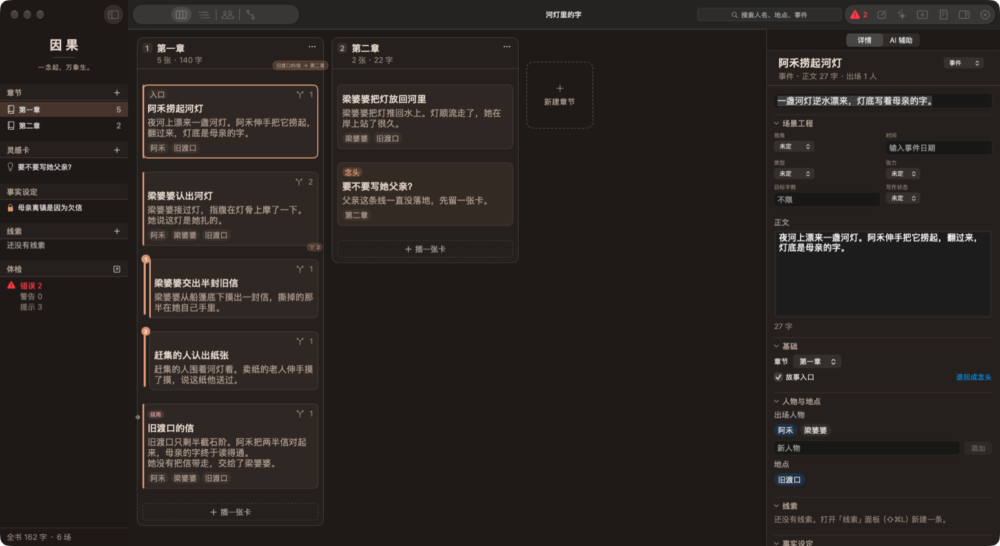
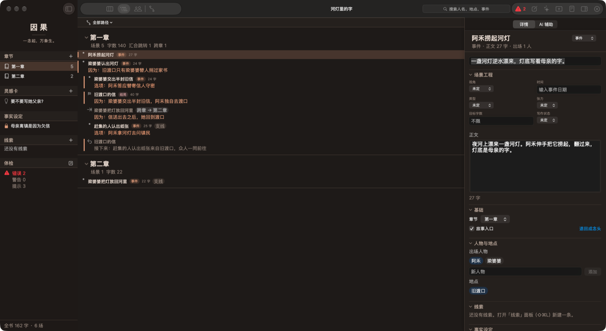
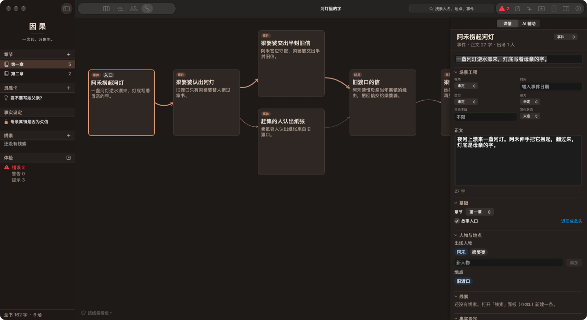
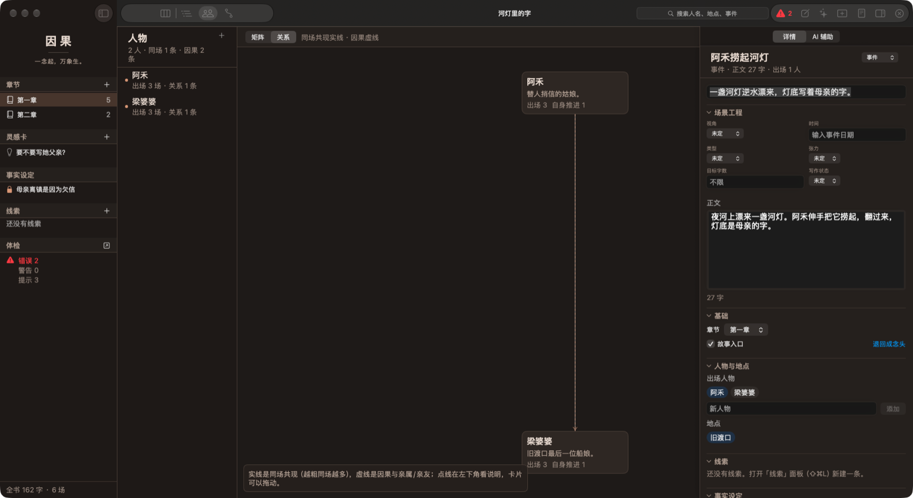
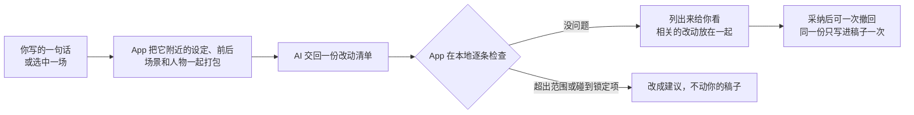
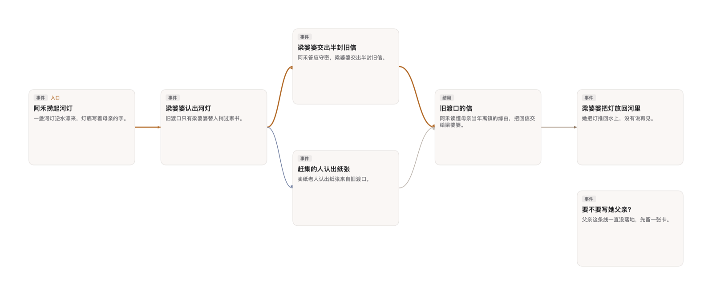
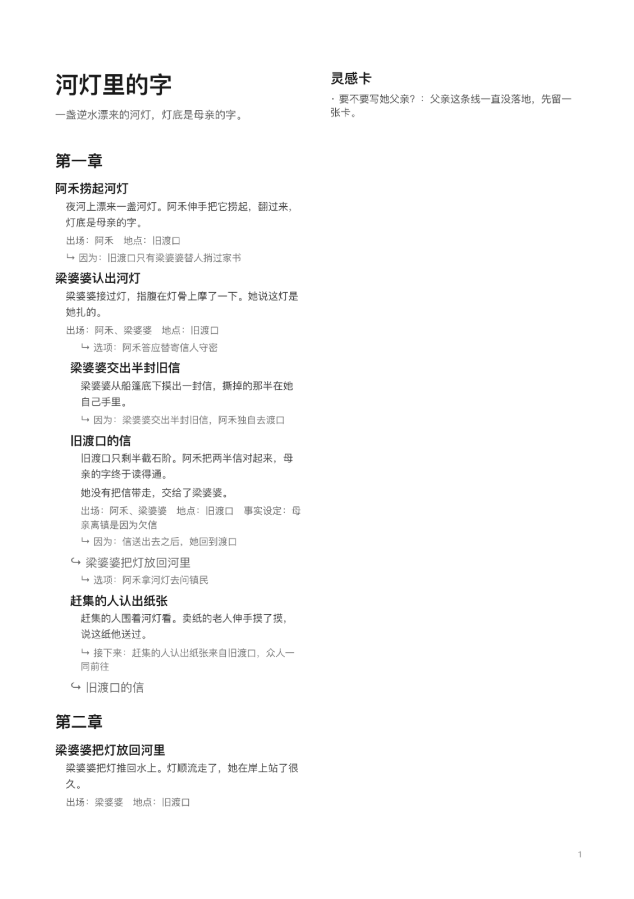

[English](README.md) · **简体中文**

# 因果 · Causality

这是给写中长篇、写分支故事的人准备的工具。它把「场景 → 选择 → 后果」摊开在你眼前，写的时候能看清结构，写完能直接导出稿子和图。

需要 macOS 15.0 或更新，Apple Silicon 和 Intel 都能跑。[下载 DMG](https://github.com/dynaeye/causality/releases/download/v1.0.0/Causality-1.0.0.dmg)，把 Causality 拖进 Applications 就行。

---

## 一、为什么做这个软件

分支故事，就是读者走到某个选择处，可以拐向另一条路的那种写法。

写长故事的时候，让人卡住的往往不是句子，是下面这几件具体的事：

- 改了一条支线，忘了另一条里的人物还在等一件不会发生的事。
- 大纲拉完才发现三个结局都挤在最后两章，中间没人做过选择。
- 伏笔埋过，要收的时候想不起埋在哪一场，翻二十个文件找。
- 跟 AI 聊剧情聊得很顺，但它直接动稿子时你没留意它改了五处，撤又撤不干净。

这几件事背后是同一个原因：故事本身是一张网，而我们手上的工具都是线。文档只能按章节往下排，文件夹只能按文件分，你想记的「这个选择导致那个后果，后果又影响另一个人」，没地方写。

「因果」就是照这个想法做的，有三条基本判断：

1. **最小的单位不是章节，是场景和岔路口。** 一个岔路口可以有几个选项，每个选项通向不同的下一场，也能写清为什么走这条路。两个选项通向同一场，也各留一条线，因为在作者心里它们不是一回事。
2. **阅读顺序和因果关系分开管。** 章内顺序管阅读节奏，连线管因果。在故事板上拖卡片只改阅读顺序，不会顺手改剧情；要改谁导致谁，得改连线。故事板、大纲、故事图、人物脉络看的是同一份内容，只是几种看法。
3. **AI 只给建议，改不改你说了算。** 模型不会直接改你的稿子，它交一份改动清单，App 逐项检查、成组给你看，你采纳之后可以一次撤回整份改动。断网的时候，除了 AI 功能，写作、查看、保存、导出都能用。

它和 Scrivener、Twine 做的事不一样，可以一起用：

| 工具 | 管什么 | 不管什么 |
| --- | --- | --- |
| Scrivener | 文本与素材的归档 | 分支能不能到达、因果有没有断 |
| Twine | 把分支故事做成能点着玩的程序 | 长文写作、成稿大纲、投稿稿 |
| 因果 | 管因果、哪条路走得到、伏笔收没收 | 当游戏引擎、版本管理、替你代写 |

它更适合八万字以上、有三个以上结局的作品。三五千字的单线短篇，用普通文档可能更顺手。

---

## 二、第一次使用

第一次打开，照下面四步走一遍；走完还有三处最容易误会的地方，列在这一节末尾。

1. **安装**：打开 DMG，把 Causality 拖进 Applications，双击启动。启动后先看到起始页：可以新建项目、打开项目，下面列着你没写完的草稿（第一次打开时这里是空的）。
2. **写第一场正文**：点「文件 › 新建项目」，新工程自带「第一章」和一张「第一张卡」。在这张卡上点右键选「写正文」，进去写第一场；写下的正文就记在这张卡上，卡面会显示开头一段。之后要加场，点这一章底部的「插一张卡」。
3. **加一条分支**：写作模式里写完这一场，从「故事 › 从本场分叉」分出一支，接着写另一个走向。回到故事板，这两场之间会多出一条分叉线，分成两个走向，旁边标着分支编号（1、2……），两条路都留着。
4. **检查结构，导出大纲**：再点一次「故事 › 写作模式」就退出写作模式。用「故事 › 体检」查结构问题，用「故事 › 分支梗概」看每个结局各要多少场、多少字，最后用「文件 › 导出大纲 PDF…」导出一份能打印的大纲。

第一次用，这三处容易卡住：

- **关窗口会直接退出「因果」**（只有一个窗口）。只想关掉当前项目、把 App 留着，用「文件 › 关闭项目」。
- **`.causal` 在访达里显示成一个文件**，其实是个文件夹。用「打开项目…」面板打开时，它会被当成文件夹显示，选中这个包本身点「打开」就行。双击文件、或把它拖到 Dock 图标上打开，都不用管这条。
- **新建和导入的项目先存成草稿**，关掉窗口也不会丢。第一次用「文件 › 保存」时，才会让你选正式存放的位置——起始页上那份「草稿」就是它。

---

## 三、四个视图

同一份工程有四种看法：排场景用故事板，看阅读顺序用大纲，检查因果用故事图，整理人物用人物脉络。

| 视图 | 一眼看什么 | 主要动作 | 怎么切过去 |
| --- | --- | --- | --- |
| 章节故事板（默认） | 一章一列，横向是全书的节奏 | 插卡、拖卡、写正文、配图 | 「故事 › 视图 › 章节故事板」 |
| 大纲 | 按章的阅读顺序，分支缩进、汇合跳转 | 调顺序、看结构、导 PDF | 「故事 › 视图 › 大纲」 |
| 故事图 | 把全书的因果画成一张图，连线就是「因为…所以…」 | 平移缩放、连线、看主线支线 | 「故事 › 视图 › 故事图」 |
| 人物脉络 | 谁和谁在同一场、谁和谁有关系 | 拖人物卡、看矩阵、改名写备注 | 「故事 › 视图 › 人物脉络」 |

### 3.1 章节故事板（默认）

一列一章，从左到右就是全书从第一章到最后一章，列内按你排的顺序从上往下。左边是章名和字数，卡面直接显示正文摘录、出场人物地点标签、配图。

- **插卡**：把鼠标停在两张卡中间会出现 `＋`；点一下出现输入框，写一句念头，按回车插进这一章，按 Esc 取消。每列底部也常驻「插一张卡」。
- **拖放**：卡能上下拖，也能拖到别的列；松手时它会插进你放的那两张卡中间。连线和正文跟着卡走。
- **主线在哪**：主线上的卡左边有一道强调色竖条，一眼能看出哪条是主干、哪条是旁枝。
- **并列组**：分叉的地方有小标记和分支编号（1、2、3……），不同分支用不同颜色区分；几条路重新汇到一起时画一个菱形。一组分支可以折起来收成一张小卡，右键能改「什么条件下走这条」，改完存进工程。

### 3.2 大纲

大纲是从同一份内容自动排出来的，不用另写一份。顺着看的场景平排，一个场景有多个去处时往里缩一层；第一次出现的场景显示正文，后面再出现只给一个跳转，不重复贴一遍；跨章的连线会标出目标章名。章头给出场景数和字数。

- 拖动只改阅读顺序，不改因果。
- 汇合处显示跳转引用，同一段正文不会出现两遍。

### 3.3 故事图

故事图只画当前屏幕里看得见的卡，以及它们之间的连线。滚轮缩放时以光标所在的位置为中心，空白处拖动平移，卡片也能拖。

- 连线平时只有颜色和粗细：主线粗，支线细而淡。鼠标移到线上才显示因果文字（「因为…」「所以…」「接下来…」）。
- 卡按阅读顺序摆成蛇形（第一行从左往右，第二行从右往左），相邻两张最多隔一格，连线不会横穿整屏。排乱了用「故事 › 重排故事图」，可撤销。
- 「之后可达的结局」：右键任意一张卡，列出从它出发能走到的所有结局和步数。改分支之前，可以先看一眼动了这处之后哪些结局会跟着变。

### 3.4 人物脉络

两种看法：**关系图**和**矩阵**。

- 关系图：每人一张卡，高度随内容长。实线是同场共现，线越粗同场越多；虚线是因果或亲属关系；鼠标停在线上才显示这条线的来源场景。卡能拖到任意位置，摆的位置会记住。
- 矩阵：每一格表示一个人物在某一章的状态，四种：出场；只被提到、人没出场；这一章没出现；这一章还没写到。旁边还有各章字数、第一次和最后一次出场、最长的空档。点格子直接跳到那一场。

---

## 四、先认这些概念

这几个词在界面上会反复出现，花半分钟认一遍，后面读起来会顺很多。

| 概念 | 在「因果」里指什么 | 这样记有什么好处 |
| --- | --- | --- |
| 场景 | 一段有正文的叙事单元，卡上显示开头一段。界面上叫「卡」，写作模式里叫「场」，都是它 | 同一场被几条路走到，也只存一份正文，不用改好几处 |
| 选择点 | 场景的一种类型：走到这里要选一条路，选项和条件写在连线上 | 改选项和理由不会动到这一场本身 |
| 结局 | 另一种类型：没有下去的路了才叫结局 | 标了结局，体检才能查出「这个结局谁也走不到」这类问题 |
| 灵感卡 | 只留在板上的念头，不进大纲 | 念头一旦混进正文，大纲里就会多出没写完的场景 |
| 发展线 | 两场之间的因果连线，带一句因果说明和可选条件。画它，就是在说「因为前一场，所以有后一场」 | 这句说明是你写给自己看的，App 不会拿它判断剧情 |
| 事实设定 | 世界观条目，草案 / 已确认 / 锁定三级 | 三档松紧不同，AI 只能动最松的那一档 |
| 线索 | 跨章的伏笔、主题、人物弧线，按章节顺序排成一条线，方便从头看到尾 | 一条线索能横跨好几章，不用一章一章去翻 |
| 章 | 阅读顺序的容器，一卡只属于一章 | 删掉一章，里面的卡也一起删；后悔了按「编辑 › 撤销」一次就能全拿回来 |

---

## 五、功能详解

下面按实际用到的顺序讲：先写，再查，最后导出。

### 5.1 写作模式

故事板适合看结构，不适合连续写正文：卡片太小，周围信息又太多。

选中一场，走「故事 › 写作模式」，中间只剩这一场的正文：上面是上一场的结尾，下面是下一场的开头，右边是这一场的人物和地点，最底下列出这一场通向哪几场，点一下就跳到那一场接着写。

「故事 › 上一场 / 下一场」翻着写，「故事 › 新建下一场」接着往下；「故事 › 从本场分叉」会复制当前这一场、新开一条分支，原来那条路不动。退出再进来，还停在你上次写的那一场。正文边写边自动保存，不用手动存。

### 5.2 详情与场景工程

右栏分成九块，默认展开「摘要」「场景工程」「正文」，其余（基础、人物、设定、配图、去向、注释）按需展开，折叠状态会记住。「故事 › 显示右栏」收起或展开右栏，「故事 › 专注模式」连侧栏一起收。

场景工程是你自己填的写作提示：视角（这场从谁的眼睛看）、时间（故事里的什么时候）、类型（这场在全书里算什么）、情绪强度（这场要绷得多紧）、目标字数、写到哪一步（想法 / 草稿 / 定稿）。都可以留空，不填也照样写。填了以后，目标字数和这一场实际字数会并排显示，人物矩阵和体检也会用到这几个字段。

**字数怎么算**：场景、章、某一条路线和全书的字数用的是同一套算法——中文按字、英文按词，标点和空格不算。所以这几个数字对得上。

**打字的时候**：正文、注释、人物简介这些长文本，打字时不会每敲一个字都重算，停一下或者切走之后才写进去；保存、导出、发给 AI 之前会把最后输入的内容一起带上，不会漏最后一段。

### 5.3 灵感卡与草稿

写到一半冒出来的念头，丢了可惜，直接塞进正文又容易把结构搅乱。

「故事 › 新建灵感卡」，或者在某列底部插一张卡，只写那一句。念头卡上带一个小角标，不进大纲、不参与因果；右键「写成正式场景」之后就变成正式的，编号、配图、在故事板上的位置都保留，从此进大纲和故事图。

草稿是另一件事：新建项目会先存成一份草稿，所以关掉窗口也不丢；正式存放位置在第一次保存时再选。起始页列着草稿和最近打开的项目（最近打开最多 5 条、草稿最多 3 份），右键能在访达里显示、另存为副本、复制路径，不要的直接删进废纸篓。超出保留份数、或者 30 天没动过的草稿会自动进废纸篓；已经正式保存过的项目不受这条影响。

### 5.4 体检

分支一多，结构上的问题就很难靠眼睛发现了。随时打开「故事 › 体检」，它按 21 条规则扫全篇，分错误、警告、提示三级——错误是故事断了、必须改，警告是读者会困惑、建议改，提示是可以留意的细节。可以筛选，点一条就能跳到对应的卡。觉得某条提醒不适用，可以填一句理由忽略它，之后还能恢复。工具栏上会出现一个红色数字，是当前的错误条数，没有错误时不显示；侧栏的体检一栏会分别列出错误、警告、提示各有多少。

这些规则主要查三类问题：路走不通（走进死路、走不到结局）、选择不成立（有分叉其实没得选）、伏笔没收（埋了没交代）。N01–N21 是这 21 条规则的编号。

| 编号 | 级别 | 含义 |
| --- | --- | --- |
| N01 | 错误 | 断头：正式场景有人走到它，却没有去向，也没标成结局 |
| N02 | 错误 | 结局悬空：标成结局，但没有任何一条线走到它 |
| N03 | 错误 | 结局还有去向：既然还有去处，它就不是结局 |
| N04 | 错误 | 不可达：没有任何路径能走到它 |
| N05 | 错误 | 没有显式入口（没标明故事从哪一场开始） |
| N06 | 警告 | 单去向的选择点（读者其实没得选） |
| N07 | 警告 | 伪选择：几个选项通向同一场景且没有区别 |
| N08 | 提示 | 无条件分叉（分了两条路，却没写凭什么走哪条） |
| N09 | 警告 | 环无出口（几个场景绕成一个圈，走不出去） |
| N10 | 提示 | 结局太近（两个结局挨得太紧，读者分不清） |
| N11 | 警告 | 分支不落结局（有路走到一半就没下文） |
| N12 | 错误 | 没有结局 |
| N13 | 提示 | 空场景（这一场还没有正文） |
| N14 | 提示 | 同名场景（有两个场景同名，容易认错） |
| N15 | 提示 | 主线未标注（故事板上看不出哪条是主干） |
| N16 | 警告 | 伏笔未收 |
| N17 | 错误 | 收在埋之前（伏笔的回收比埋设还早） |
| N18 | 警告 | 设定冲突（两条设定互相矛盾） |
| N19 | 提示 | 人物断层（长时间不出场） |
| N20 | 提示 | 结构和类型对不上（看着该分叉的地方没有分叉，或选项处放的不是选择点） |
| N21 | 提示 | 线性结构（全书只有一条路，没有分支） |

### 5.5 分支梗概

写到一半常常要回答一个问题：现在有几个结局、各自路线多长。打开「故事 › 分支梗概」，就能看到每个结局的场数、字数和选择次数，还有哪几场不能跳过。可以按故事的大段落看节奏，也可以一步一步看顺序；内容能导出 Markdown，也能让 AI 改写得更好读。

### 5.6 线索

伏笔、主题、人物弧线往往横跨好几章，只按章整理很容易漏掉。在「故事 › 线索」里新建一条，把场景挂进去，它会按章节顺序排成一条线，一眼能看到这条线经过了哪些场景。这条线经过的卡片上会出现一个小圆点（属于几条线就显示几个点），故事图还能「按线索着色」，只看这一条线怎么走。体检里的「伏笔未收」和「收在埋之前」，查的就是这条线有没有接上。Markdown 和 PDF 导出会带上线索附录。

### 5.7 试玩

结构顺不顺，自己读一遍最准，可从头读到尾往往要半天。「故事 › 试玩」从入口开始一路走下去，每到选择点给出可选项，面板里列出走过的场景，点前面任意一个就能退回去重选，还会累计这一路走了多少字。走不通的地方会直接告诉你是哪个入口。走完能导出试读稿，标着每一步选了什么。

### 5.8 搜索

工具栏搜索框按人名、地点、事件名找卡，命中的卡直接跳过去。人物脉络里点一个人，也能反查他的全部出场。

### 5.9 AI 辅助

你可以先写一句话，让 AI 帮你整理成一场场能写的大纲。它会给出改动清单，采纳不采纳由你定。

右栏切到「AI 辅助」，或者点工具栏的 AI 按钮。三个入口：

- **讨论**：只写进对话记录，不动稿子。聊出来的句子可以「收为灵感」或「记为设定」。
- **整理成大纲**：把已有共识整理成场景，没定的问题留成待定项，交一份提案。
- **改选中的内容 / 在这里插一张卡**：先在两张卡中间的缝上点一下，面板会显示「插入位置：第一章 · 在「…」之后」，这时主按钮变成「在这里插一张卡」。

发送前，下方会列出这一轮要发出去的材料，可以逐条移掉，移掉的不会再发；范围能切「本章 / 全书」；讨论默认带最近 12 轮。改动写进稿子之后，按「编辑 › 撤销」一次撤掉；撤销之后，同一份改动还能再采纳一次。AI 写到一半停了，你输入的内容和原稿都还在，出错信息会记在对话里。

**一次带多少**：最多带一万多字的材料，超出时会按所用服务的上限精简。发送前可以逐条删掉不想带的内容；请求失败会自动重试两次，已经收到的内容会保留下来。

### 5.10 事实设定

世界观条目分三级：草案、已确认、锁定。草案只存在本地；已确认的会随材料一起发给 AI；锁定的不能被 AI 改、删或解锁，删掉引用它的场景也不会把它一起删掉。

### 5.11 导入 Markdown

如果你手上已经有剧本、分场大纲或者设定文档，就不用从零开始建卡。走「文件 › 导入 Markdown…」选一个 `.md`，程序按文件格式分成两种导法：

- 文件里有以「节点与时机」开头的那张表 → **按故事板导入**：每行变一张卡，按表格里的先后顺序放进它该在的那一章，四列内容一起写进正文。它不替你连因果线，表里「从哪个场景出发 / 接下来发生什么」是给人读的，导完得自己在故事图上连。
- 普通 Markdown → **按散文导入**：`#` 当书名、`##` 当章、`###`（或 `####`）当场，段落进正文；`## 人物 / ## 地点 / ## 设定` 这类小节会被当成设定清单，不当章节（「角色 / 场所 / 世界观」这些写法也认）。

导进来的项目和你新建的一样，先存成草稿，第一次保存才选正式位置。散文导入会告诉你这个项目有几章、几场（提示里显示成「N 章 M 场」）；解析时发现的问题列在提示里，改完原文再导一次。

---

## 六、怎么设定

设置分两个页签，从「因果 › 设置…」进去。

### 6.1 外观

- 模式：跟随系统 / 浅色 / 深色。
- 配色：20 套，浅色和深色各一版，每套下面有同款迷你故事板预览，可以直接看效果。
- 字号：正文 16；标题按层级放大（面板标题 22，写作模式 28）；画布和卡面上的标签更小；把故事图缩小到一定程度后，卡面只显示标题。文字和背景的对比度按可读标准调过，浅色和深色下都清楚。
- 界面语言：跟随系统 / 简体中文 / English / 日本語 / 繁體中文。菜单栏和「关于」窗口里的文字，重启后才换语言。

### 6.2 AI 服务

你用哪个 AI 账号，就在这里点哪个服务，密钥框显示成星号。除 ChatGPT 外，都要去各家服务自己的网站申请 API key，粘进来保存就行；表里没列出的服务，用最下面的「自定义提供商」自己填接口。

| 服务 | 用法 |
| --- | --- |
| ChatGPT | 用本机已登录的 Codex（装过 Codex 并登录过就能用），不用填密钥 |
| DeepSeek | 填 DeepSeek 的 API key |
| OpenCode Go | 填 OpenCode Go 的 API key |
| OpenRouter | 填 OpenRouter 的 API key |
| Kimi | 填 Kimi 的 API key |
| MiniMax（中国站） | 填 MiniMax 的 API key |
| 通义千问 | 填通义千问的 API key |
| Google Gemini | 填 Gemini 的 API key |
| 豆包（火山方舟） | 填火山方舟的 API key |
| 自定义提供商 | 自己填接口地址和模型名 |

**模型分工**：不必所有活都用一个服务，可以分成「策划 / 大纲」和「写作」两类，各自选服务和模型。比如策划用 ChatGPT 聊结构，写作交给 DeepSeek 改句子。

**密钥安全**：密钥只保存在这台电脑上，界面上只显示星号；它不会写进工程包，不会写进导出文件，也不会进安装包。装到别的机器上，看到的是那台机器自己的凭据；没配置的服务会显示「未配置 API key」。安装包和工程包里不含任何账号或登录态。

**用 ChatGPT 的话**：如果你在这台电脑上装过 Codex 并登录过，选 ChatGPT 就能直接用——App 只是读那份登录，不改、也不复制。没登录过会显示「未登录」，过期会提示你重新在网页上登录，不会悄悄失败。

---

## 七、怎么输出

导出有几种走法，都不需要联网：继续编辑用工程包，继续写作用 Markdown，贴给别人看用 PNG，打印批注用 PDF，内部试读用试读稿。

### 7.1 `.causal` 工程包

`.causal` 其实是个文件夹，访达里显示成一个文件，能复制、能发给自己、能换机器继续写。里面有正文、结构、连线、画布位置、配图和讨论记录。

保存时会先把新内容写好，再替换旧文件，所以中途退出也不会留下半份工程；包里还留着一份上一版快照，需要时能找回。App、命令行、其他工具同时改同一个包时，后保存的一方会停下来让你选：另存一份、用新内容覆盖文件，还是重新载入文件里的内容。

### 7.2 Markdown

「文件 › 导出 Markdown…」按章导出，保留场景标题、出场人物与地点、因果文字、选项与条件、结局标记；图片用相对路径放在同目录。大纲视图怎么排，导出的 Markdown 就怎么排，内容不会变样。

### 7.3 故事图 PNG

「文件 › 导出故事图 PNG…」可以导出整张故事图，也可以只导出当前屏幕上看到的那块，白底，连线上的中文保持可读。适合放进策划笔记，或者发给别人看结构。

### 7.4 大纲 PDF

「文件 › 导出大纲 PDF…」出 A4 双栏，按章分页，正文和配图一起排（配图会缩到能放进页面的大小），末尾带线索附录。灵感卡单独一栏，方便通读批注。

### 7.5 试读稿

从试玩面板导出：一条路线从上到下的正文，标着每个选择点选了什么。做内部试读、给测试的人看都行。

### 7.6 命令行与给 AI 用的接口

另外还有一套命令行工具（`causal`），能批量检查、导出、改工程，适合塞进脚本里跑；命令和参数见 `docs/cli.zh-Hans.md`。同一套东西也提供 MCP 接口，让 Codex、Hermes、Pi 这类 AI 客户端直接读写工程，装法见第九节。改完要保存才会写进文件；两个程序同时改同一个包时，会停下来让你选，不会悄悄覆盖。

---

## 八、性能

用一个 500 场、800 条连线、12 章的工程测过，在一台 Apple Silicon 的 Mac 上跑 `causal bench`：

| 项 | 结果 |
| --- | --- |
| 打开这个工程 | 68 ms（五次的中位数） |
| 查一次场景 / 出一次大纲 | 1.2 ms / 1.0 ms |
| 导出 Markdown | 3.4 ms |
| 常驻内存 | 20 MB |

这种规模的工程，故事图会自动摊开更多列；平移缩放时只简化远处的显示，不会卡住。

---

## 九、让 AI 从外部生成故事板（MCP / CLI）

装完 App 就能用，不需要开终端。

### 9.1 一键装好（点一次）

打开 **设置（⌘,）› MCP**，点「一键安装 MCP」。这一个按钮连着做完三件事：把自己带的 `causal`（MCP 服务器就是它）装进主目录下的 `.local/bin`；把它写进这台机器上已装的 Codex（GPT）、Hermes、Pi；再逐个试一遍能不能连上。全程不用开终端、不用打开任何配置文件。

路径是当场读你的主目录算出来的，不是写死的某台机器。整套只做一次；App 升级后再点一次就换成新版本。菜单 **工具** 里也有同样入口。

### 9.2 看它连没连上

同一页往下，客户端一行一行列出来，每行末尾就是结论：

| 显示 | 意思 |
| --- | --- |
| 已接入，15 个工具可用 | 配置写好了，握手成功 |
| 还没接入 | 客户端装了，但它的配置里没有因果 |
| 没连通：原因 | 写失败或连不上，原因写在冒号后面 |

没接入的再点一次「一键安装 MCP」，或点那一行的「重新检查」。

再往下是**桌面类客户端**：Claude 桌面版、Cursor、Windsurf、Kiro、VS Code、OpenCode。装了哪个，它自己就会出现在列表里（这类客户端没有命令行，靠一份 JSON 配置接入）。判断「装没装」只看 App 在不在、命令行在不在——光有一个空的配置文件不算，所以不会冒出你没装过的客户端。点「写入并检查」——App 直接改它那份配置文件，改之前把原文件备份成 `…bak-mcp-<时间>`，写完回读核对一遍；每行下面显示的就是那份文件的确切路径，点「在访达中显示」能直接看到。它的配置原本不是标准 JSON 时，App 不动手，把原因写在那一行。

两栏都没有的（DSH 这类没有固定位置的）才需要手工：点「复制这段配置」，去那个客户端的设置里找 MCP 一项粘进去。**别手动选中预览文字复制**：那样会带出 `\n`、`&#x20;` 之类的转义，贴进去就是坏的。

装好后在终端里敲 `causal`，如果提示找不到命令，是因为 `.local/bin` 不在默认 `PATH` 里。写成完整路径就能用——App 写入配置时用的就是完整路径。

### 9.3 让 AI 建一块故事板

把下面这段贴给已经连上 MCP 的会话（路径与内容换成你自己的）：

> 用 causal 建一个工程 `/Users/你/Documents/雨夜来信.causal`：先 `open_project`；建三章「第一幕 / 第二幕 / 第三幕」，每章 4 场，标题写成「S01 信封」这种，正文 60 字左右，写清地点、人物、这一场推进什么；场与场用 `connect` 连起来；设两处岔路，各两条出边，最后汇到同一个结局；每批改完 `validate`，全部完成再 `save_project`；最后报给我几章、几场、几处分叉、几个结局。

四个容易返工的地方：

- `apply_ops` 只改内存，**不 `save_project` 就等于没保存**。
- 引用卡片写名字就行，不用 UUID；重名它会报错并列出候选。
- 改坏了 `undo`；想先看历史用 `history`。
- 体检不在 MCP 里：回 App 按 `⇧⌘A`，或命令行 `causal audit 你的工程.causal`。

### 9.4 回到 App 看结果

双击那个 `.causal` 包，故事板里就是它刚写的卡片；`⇧⌘A` 体检看有没有断头或缺结局，`⇧⌘B` 看每个结局要多少场。App 和 AI 同时改同一个包时会停下让你选（另存为 / 覆盖磁盘 / 重新载入 / 取消），不会悄悄覆盖。

配置文件放在哪、15 个工具与操作清单、排错，见 `docs/mcp.zh-Hans.md`。

---

## 十、快捷键

这里列的是快捷键。其余操作都能用菜单完成，记不住也不影响用。

| 快捷键 | 作用 |
| --- | --- |
| `⌘N` / `⌘O` | 新建项目 / 打开项目 |
| `⇧⌘R` | 重命名项目 |
| `⇧⌘I` | 导入 Markdown |
| `⌥⌘W` | 关闭项目 |
| `⌘S` / `⇧⌘S` | 保存 / 另存为 |
| `⇧⌘E` / `⇧⌘G` / `⇧⌘P` | 导出 Markdown / 故事图 PNG / 大纲 PDF |
| `⌘Z` / `⇧⌘Z` | 撤销 / 重做 |
| `⌥⌘N` | 新建场景 |
| `⌘⏎` | 进入 / 退出写作模式 |
| `⌘↑` / `⌘↓` | 写作模式下上一场 / 下一场 |
| `⇧⌘⏎` | 新建下一场 |
| `⇧⌘D` | 从本场分叉 |
| `⇧⌘A` | 体检 |
| `⇧⌘B` | 分支梗概 |
| `⇧⌘L` | 线索 |
| `⌥⌘P` | 试玩 |
| `⌥⌘I` / `⌥⌘R` | 显示右栏 / 专注模式 |
| `⌘,` | 设置 |

---

## 十一、许可与反馈

MIT 授权，完整条款见 `LICENSE`。想一起改代码，看 `CONTRIBUTING.md`；发现安全问题，按 `SECURITY.zh-Hans.md` 里写的地址报，不要发在公开 issue 里。

用下来发现问题，或者觉得哪句话写得不对，欢迎在仓库里开个 issue 说一声。
